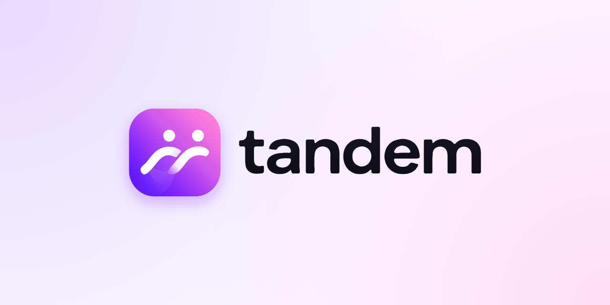

<p align="center">
  <picture>
    <source media="(prefers-color-scheme: dark)" srcset="public/tandem/tandem-github-banner-dark.png">
    
  </picture>
</p>

<p align="center">Work in good company.</p>

<p align="center">
  <a href="https://github.com/janyksteenbeek/tandem/actions/workflows/tests.yml"></a>
  <a href="https://github.com/janyksteenbeek/tandem/actions/workflows/docker.yml"></a>
  <a href="https://github.com/janyksteenbeek/tandem/releases"></a>
  <a href="LICENSE"></a>
  <a href="https://github.com/janyksteenbeek/tandem/issues"></a>
</p>

---

Tandem is a worksuite for teams: email, project tracking and video meetings in one app, with one set of people, teams and permissions. You host it yourself. Free and public source.

## What's inside

### Mail

An email client for people and the teams they work in. Connect your own Gmail or IMAP accounts and use it as your everyday mail app, then run `support@` or `sales@` together in shared inboxes.

- **Personal mail**: multiple accounts, identities, threading, snooze, search, keyboard navigation.
- **Team inboxes**: assignments, Open / Waiting / Later / Done, tags, internal comments with mentions, presence.
- **Share or transfer**: move a personal conversation into a team inbox without touching your provider.
- **Providers**: Gmail API, IMAP/SMTP, and Cloudflare Email Routing for forwarded addresses.

### Projects

Issue tracking for work that crosses teams.

- **Products, projects and initiatives**: products with modules and releases, projects with milestones and health, initiatives that group projects. Private projects stay hidden from non-members.
- **One issue, several teams**: each team gets its own workstream on an issue, with its own status, assignees, estimate, due date and dependencies.
- **Cycles**: sprints per team, so the same issue can sit in an Engineering cycle and a QA cycle at once.
- **Views**: list, board, calendar and timeline, with saved filters, full-text search and reports.

### Calls

Video meetings on your own server.

- **Instant meetings**: a shareable link, guests without an account, a waiting room, a password and a lock.
- **Screen sharing and chat**: chat and shared files stay with the meeting afterwards and can be emailed to the attendees.
- **Recording**: done on the server with one file per track, then played back in sync, downloaded, or exported as audio or video.
- **One extra process**: a single Go binary with the media server and the recorder. See [Calls](docs/calls.md) for what it needs.

### Across all three

- **Linked work**: turn a conversation into an issue or link the two, start a call from an issue or a project, drop a meeting link into an email.
- **Automations**: triggers, conditions and actions for conversations and issues, with templates, business hours and auto-responders.
- **Organizations and teams**: roles, Google sign-in, passkeys, in-app and push notifications, a command palette, and your own name, logo and colours.

## Quick start

```bash
composer install && npm install
cp .env.example .env && php artisan key:generate
php artisan migrate --seed
npm run build
php artisan serve
```

Needs PHP 8.4, MySQL and Redis. Sign in with `demo@tandem.test` / `password`.

For realtime, queues and scheduled sync, also run:

```bash
php artisan reverb:start
php artisan horizon
php artisan schedule:work
```

Mail and Projects work with just this. Meetings also need the media server, which is one Go build and a few `.env` lines: see [Calls → Local development](docs/calls.md#local-development).

Or run the whole stack, media server included, with Docker. Set `LIVEKIT_API_KEY` and `LIVEKIT_API_SECRET` (32 characters or more) in `.env` first:

```bash
docker compose up --build
```

## Tests

```bash
php artisan test --compact
npm run types:check && npm test
cd media/tandem-media && go test ./...
```

## Docs

- [Architecture](docs/architecture.md)
- [Deployment](docs/deployment.md)
- [Projects](docs/projects.md)
- [Calls](docs/calls.md)
- [Automations](docs/automations.md)
- Mail providers: [Gmail](docs/providers/gmail.md) · [IMAP](docs/providers/imap.md) · [Cloudflare](docs/providers/cloudflare.md)

## License

Tandem is released under the Creative Commons Attribution-NonCommercial 4.0 International license. See
the [LICENSE](LICENSE). A human friendly summary is available
at [creativecommons.org](https://creativecommons.org/licenses/by-nc/4.0/). An addendum regarding clarification of
non-commercial use is available at [NON-COMMERCIAL.md](NON-COMMERCIAL.md).

Dependencies may be subject to their own licenses.

## Security

If you discover any security-related issues, please email [tandem@janyk.dev](mailto:tandem@janyk.dev) instead of using
the issue tracker. All security vulnerabilities will be promptly addressed.
